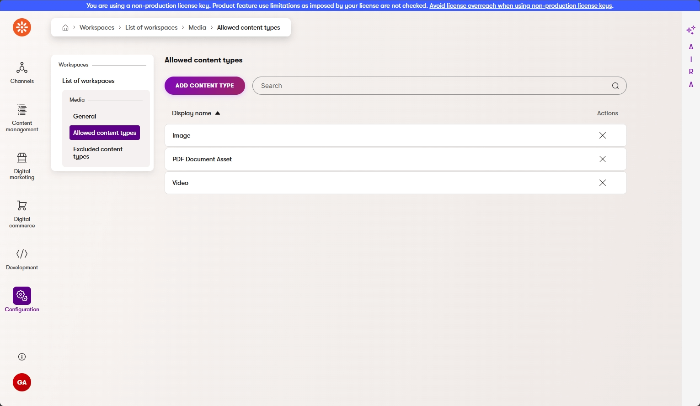
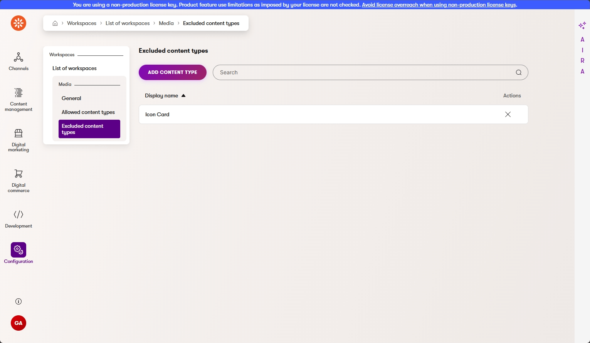
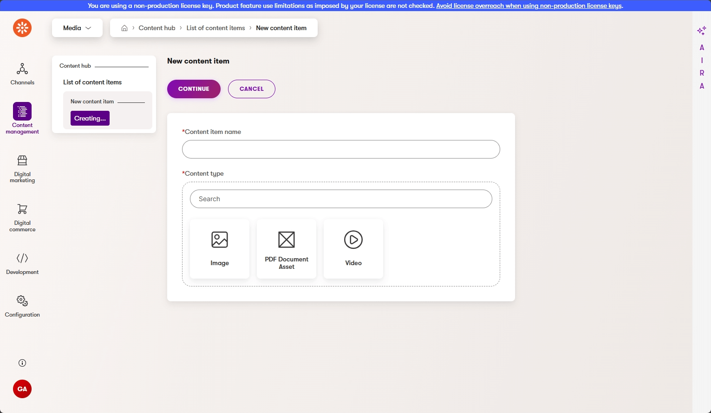

# Xperience Community: Workspace Restrictions

[](https://www.nuget.org/packages/XperienceCommunity.WorkspaceRestrictions)
[](https://www.nuget.org/packages/XperienceCommunity.WorkspaceRestrictions)
[](https://github.com/liamgold/xperience-community-workspace-restrictions/blob/main/LICENSE.md)
[](https://github.com/liamgold/xperience-community-workspace-restrictions/actions/workflows/ci.yml)
[](https://github.com/liamgold/xperience-community-workspace-restrictions/stargazers)

## Description

Restricts which reusable content types are available when creating content items in a workspace or one of its folders in [Xperience by Kentico](https://www.kentico.com/).

- **Allow list**: Only the listed content types appear in the "Create content item" dialog for the workspace.
- **Exclude list**: All content types except the listed ones appear in the "Create content item" dialog for the workspace.
- **Folder scopes**: Further restrict the content types available in a selected folder using its own allow or exclude list, optionally applying the scope to all nested folders. The available choices are limited to content types permitted by the parent workspace. See [Folder Scopes](#folder-scopes).

> The allow list takes precedence over the exclude list. If any allowed content types are configured, the exclude list is ignored for that workspace.

## Screenshots

The **Allowed content types** tab on a workspace builds an allow list:
<a href="/src/images/AllowedContentTypes.png">
  
</a>

The **Excluded content types** tab builds an exclude list:
<a href="/src/images/ExcludedContentTypes.png">
  
</a>

When an editor creates a content item, the content type picker is filtered by the workspace configuration:
<a href="/src/images/FilteredContentTypePicker.png">
  
</a>

## Library Version Matrix

| Xperience Version | Library Version |
| ----------------- | --------------- |
| >= 31.9.3         | 2.0.0           |
| >= 31.2.1         | 1.0.0           |

## Dependencies

- [ASP.NET Core 10.0](https://dotnet.microsoft.com/en-us/download)
- [Xperience by Kentico](https://docs.kentico.com/documentation/changelog)

## Package Installation

Add the package to your Xperience by Kentico admin project using the .NET CLI:

```powershell
dotnet add package XperienceCommunity.WorkspaceRestrictions
```

## Quick Start

1. Install the NuGet package above. No service registration is required. The package installs its database tables when the application starts.

1. In the Xperience administration, go to **Content hub** → **Configuration** → **Workspaces** and open the workspace you want to restrict.

1. Use the **Allowed content types** tab to build an allow list, or the **Excluded content types** tab to build an exclude list.

1. That's it. Changes take effect immediately, without a restart. Create a content item in the workspace to see the filtered content type picker.

## Folder Scopes

1. Open the workspace's **Folder scopes** tab.
2. Select **New folder scope**, choose a folder in that workspace, optionally enable **Apply to child folders**, and save.
3. Configure the scope's **Allowed content types** or **Excluded content types** tab, using the same controls as workspace restrictions.
4. Create a content item from that folder in the Content hub to see the filtered content type picker.

Each folder can have one scope. **Apply to child folders** is off by default, including for existing scopes after upgrading. When enabled, the scope also applies to all descendants, including folders created later. A folder without its own scope still receives any applicable ancestor scopes; if none apply, it uses the workspace restrictions alone.

The database enforces one scope per workspace/folder, including when users save concurrently. If an older preview contains duplicate scopes, reconcile them before upgrading; installation does not automatically delete or merge conflicting rules.

To edit an existing scope, open it from the listing. It opens on **Settings**, the first item in the scope navigation, followed by **Allowed content types** and **Excluded content types**. Change **Folder** to another folder in the same workspace or toggle **Apply to child folders**, then save. Changing the folder preserves the scope's allowed and excluded content type selections. A folder that already has another scope cannot be selected as the destination.

The workspace rules, every applicable ancestor scope, and the folder's own scope are combined. A content type must be permitted by all of them. Within each scope, a non-empty allow list takes precedence over that scope's exclude list. Empty lists add no restrictions. A child scope cannot restore a type blocked by an ancestor, and leaving its **Apply to child folders** setting off does not stop inheritance from higher ancestors. For example, if a workspace allows **Article**, **Image**, and **Video**, a parent scope can exclude **Video** for its whole subtree, and a child scope can narrow the choices further to **Image**.

A folder scope cannot make a workspace-disallowed type available. Changes to workspace restrictions take effect immediately, including for existing scopes. Previously selected types remain visible in the scope's existing bindings so they can be removed, but unavailable types cannot be added. If none of a folder's allowed types remain permitted by the workspace, the picker offers no types.

Delete a scope from the **Folder scopes** tab to remove its restrictions from the folder and any affected descendants; workspace rules and other applicable scopes remain in effect. Scopes reference folder IDs, so renaming a folder keeps its configuration. Moving a folder changes which ancestor scopes it inherits. Folder scopes apply to ordinary content folders, not smart folders or the **All content items** view.

Like workspace restrictions, folder scopes filter the administration's content creation picker. They do not validate API imports or moves of existing items between folders.

## Running the Example Project

The repository includes a Dancing Goat sample site in `examples/DancingGoat`, generated from the Xperience by Kentico 31.9.3 template. It references the library project, so the module installs when the site starts. To run it locally:

1. Create the database from the `examples/DancingGoat` folder. This uses the database manager version pinned in the project's tool manifest, so the schema and sample data match the Xperience version used by the example:

   ```powershell
   cd examples/DancingGoat
   dotnet tool restore
   dotnet kentico-xperience-dbmanager -- -s "(localdb)\MSSQLLocalDB" -d "WorkspaceRestrictions-DancingGoat" -a "<admin password>" --hash-string-salt "d52e99dd-0eb1-4ae0-8e67-884901247292" --sample-website-domain "localhost:46629" --license-file "<path to license file>"
   ```

   The connection string in `appsettings.json` uses SQL Server LocalDB. Change it if you use a different SQL Server instance. A license key valid for `localhost` is required for the site to render.

2. Run the site:

   ```powershell
   dotnet run --project examples/DancingGoat/DancingGoat.csproj
   ```

3. Sign in to the administration at `http://localhost:46629/admin` as `administrator`, and configure a workspace under **Content hub** → **Configuration** → **Workspaces**.

## Contributing

Feel free to submit issues or pull requests to the repository, this is a community package and everyone is welcome to support.

## License

Distributed under the MIT License. See [`LICENSE.md`](LICENSE.md) for more information.
